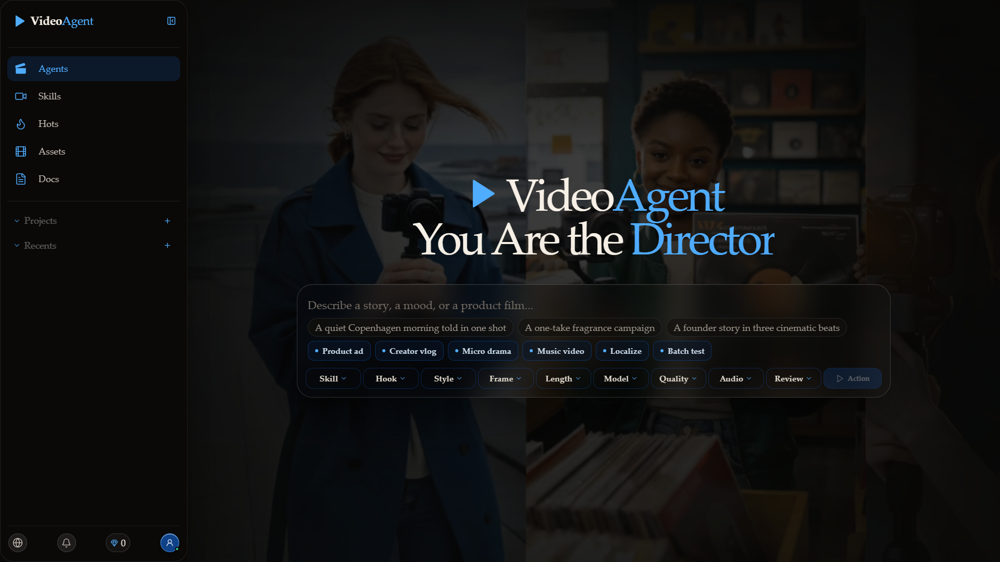
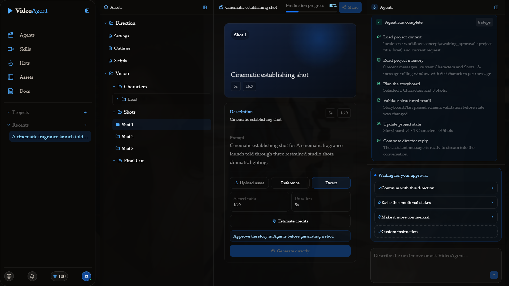
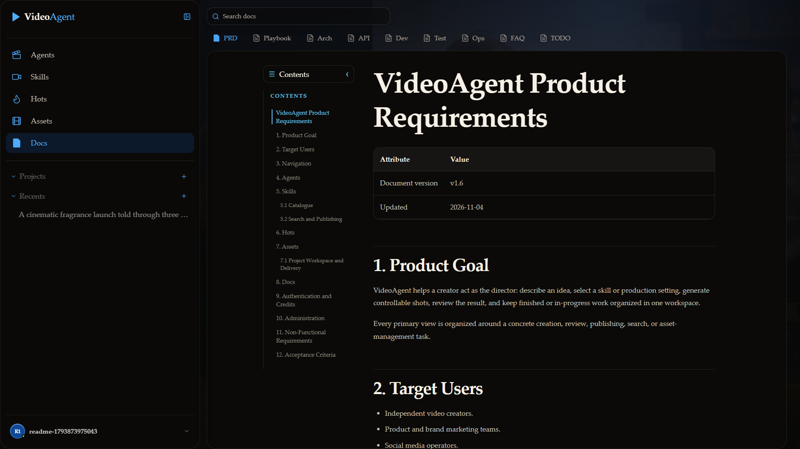

# VideoAgent

VideoAgent is an AI video creation workspace. It treats the user as the director:
describe an idea, shape the direction with an agent, generate controlled visual
resources, review the final cut, and deliver or share the result.

The product interface is available in English and Simplified Chinese.
Documentation includes matching editions in both languages.

[Live project homepage](https://0x0addc001.github.io/VideoAgent/) ·
[Product requirements](docs/product-requirements.en.md) ·
[Software design](docs/software-design.en.md) ·
[API reference](docs/api-reference.md)



## Current Product

- Agent-led directing workflow for editable settings, outline, script,
  characters, scenes, shots, final cuts, and delivery.
- IDE-style project workspace with Direction and Vision resource trees.
- Characters and Scenes own editable descriptions and uploaded references.
- Shots open one combined Description and Generation page with upload,
  reference-image, and direct-generation modes.
- Observable Agent runs with durable `context`, `memory`, `skill`, `planning`,
  `validation`, `state`, and `reply` events.
- Project folders and chronological conversation history with drag-to-file
  organization.
- Reusable Skills with AI-assisted authoring, category filters, unique likes
  and uses, leaderboard score, and persisted reward projections.
- Searchable Videos feed with category filters and unique-like rankings, plus an
  Assets library for videos and Skills.
- Pippit CLI and Kling China-region CLI video generation behind one provider
  interface, with an optional Kling MCP backend.
- Mock generation for development and tests without paid provider calls.
- Final Cut visual evaluation using configurable multimodal evaluator models.
- FFmpeg delivery, captions, soundtracks, covers, downloads, expiring asset
  links, project collaboration with view/edit access, and publishing.
- Environment-allowlisted administration console for users, credits, jobs,
  invites, provider status, runtime controls, and audit logs.

## Screenshots

### Project workspace

The workspace combines project history, Direction/Vision resources, a Shot
editor, sharing controls, and the observable Agent trace.



### Documentation

Documentation is rendered inside the product. The static project homepage uses
the same generated documentation pages.



## Agent Runtime

The current Agent is a bounded production planner, not an unrestricted ReAct
loop. One run performs the following steps:

1. Persist the user request and its `run_id`.
2. Assemble bounded project Context and short-term Memory.
3. Resolve an optional user-owned Skill.
4. Execute the LangGraph `plan_storyboard` node.
5. Validate the `StoryboardPlan` with Pydantic.
6. Persist Characters, Scenes, Shots, messages, and workflow state.
7. Return the director response.

The frontend polls
`GET /projects/{project_id}/agent-activity/{run_id}` while waiting and renders
only the execution steps that actually occurred.

Only work that actually occurred is displayed. The Storyboard Agent does not
hold pay-per-use MCP tools, so planning cannot create an unreviewed billable
side effect.

### Context and Memory

- Context includes project title, brief, current request, locale, workflow
  stage/status, current Character/Shot summaries, recent conversation, and
  optional Skill instructions.
- Short-term memory uses the eight most recent historical messages, clipped to
  600 characters each, and excludes the current request.
- Storyboard context is capped at 20 Shots.
- Long-term memory is the relational source of truth: projects, conversations,
  messages, workflows, storyboards, Characters, Scenes, Shots, assets, and
  generation jobs.
- No vector database or cross-project user memory is enabled.

### Skills and MCP

The composer writes the selected Skill into the project production settings.
The Context Builder resolves a current-user Skill and attaches its persisted
instructions when available. Built-in Skills otherwise contribute their Skill
ID as a directing constraint.

Kling MCP remains in the provider layer. An explicit user approval reaches the
Generation API, which resolves the selected Provider/model and then invokes the
Kling MCP tool client or China-region CLI. The Storyboard Agent cannot call
these billable tools directly.

Character image generation currently uses the Kling China-region CLI for
text-to-image and reference-image-to-image.

## Final Cut Review

Final Cut review is separate and runs only on an exported film. Users choose a
configured multimodal evaluator and one or more metrics:

- Character consistency
- Style consistency
- Prompt alignment
- Temporal stability

The API extracts representative frames with FFmpeg and sends them to the
selected OpenAI-compatible vision endpoint. If no evaluator is configured, the
UI reports that explicitly and never fabricates scores.

```env
VIDEOAGENT_VISION_BASE_URL=
VIDEOAGENT_VISION_API_KEY=
VIDEOAGENT_VISION_MODELS=[]
VIDEOAGENT_VISION_TIMEOUT_SECONDS=120
```

## Architecture

```text
Director
  │
  ▼
Next.js product shell
  │ HTTPS
  ▼
FastAPI control plane
  ├─ Auth · approval · credits · idempotency
  ├─ Agent runtime
  │    Context/Memory → LangGraph → Planner → StoryboardPlan
  ├─ Domain services
  │    projects · versions · assets · collaboration · visual review
  └─ Generation jobs
       │
       ▼
Redis broker → Celery worker → Provider resolver
                                  ├─ Pippit CLI
                                  ├─ Kling China CLI / MCP
                                  └─ Mock Provider
       │
       ▼
PostgreSQL/SQLite + Media/MinIO
  │
  ▼
FFmpeg
  │
  ▼
FinalCuts → share · collaborate · publish
```

| Layer | Technology |
| --- | --- |
| Product UI | Next.js 16 App Router, React 19, TypeScript, Tailwind CSS |
| Shared landing UI | React package and Vite static build |
| API | Python 3.12, FastAPI, SQLAlchemy async |
| Agent | LangGraph, LangChain OpenAI-compatible provider, Pydantic |
| Default database | SQLite for local development; PostgreSQL for production-like deployment |
| Background work | Celery and Redis |
| Media | FFmpeg, local media storage, optional MinIO deployment |
| Video providers | Pippit CLI, Kling China-region CLI, optional Kling MCP, Mock |
| Testing | pytest, Vitest, Playwright |

The repository separates product UI, reusable landing UI, backend control
plane, Agent runtime, Provider adapters, release documentation, deployment
infrastructure, and browser-level acceptance tests.

The GitHub Pages homepage is static. The full application remains a
Next.js/FastAPI deployment because Pages cannot run the API, provider CLIs,
Celery, FFmpeg, or persistent media services.

## Requirements

- Python 3.12+
- `uv`
- Node.js 24+
- pnpm 11+
- FFmpeg and ffprobe
- Pippit CLI 1.0.48+ for live Pippit generation
- `@klingai/cli-cn` for Kling China-region generation

Docker is optional locally. The included Compose configuration starts
PostgreSQL, Redis, and MinIO for production-like development.

## Quick Start

Install backend dependencies:

```powershell
cd services\api
uv sync --dev
```

Authorize optional live providers on the API host:

```powershell
npx @pippit-dev/cli@latest install
pippit-tool-cli login
pippit-tool-cli status

npm install -g @klingai/cli-cn@latest --registry=https://registry.npmjs.org
kling login
kling who_am_i
kling account
```

Start the API with the Windows UTF-8 script:

```powershell
cd D:\_Science\Agent\VideoAgent
.\scripts\dev-api.ps1
```

Start the web application in a second PowerShell window:

```powershell
cd D:\_Science\Agent\VideoAgent
.\scripts\dev-web.ps1
```

For persistent provider polling:

```powershell
$env:VIDEOAGENT_CELERY_ENABLED = "true"
.\scripts\dev-worker.ps1
```

Open:

- Product: <http://localhost:3000/en>
- API documentation: <http://localhost:8000/docs>
- API health: <http://localhost:8000/api/v1/health>
- Administration: <http://localhost:3000/en/admin>

The no-Docker path stores local data in
`services/api/.data/videoagent.db`.

## Configuration

Copy `.env.example` into a private environment configuration. Never commit API
keys, OAuth tokens, credentials, or session secrets.

Important provider and runtime variables:

```text
VIDEOAGENT_DATABASE_URL
VIDEOAGENT_SESSION_SECRET
VIDEOAGENT_TOKEN_ENCRYPTION_KEY
VIDEOAGENT_ADMIN_EMAILS
VIDEOAGENT_REGISTRATION_MODE
VIDEOAGENT_GENERATION_ENABLED
VIDEOAGENT_VIDEO_PROVIDER
VIDEOAGENT_PIPPIT_CLI_COMMAND
VIDEOAGENT_PIPPIT_ACCESS_KEY
VIDEOAGENT_PIPPIT_VIDEO_MODEL
VIDEOAGENT_PIPPIT_VIDEO_RESOLUTION
VIDEOAGENT_PIPPIT_TIMEOUT_SECONDS
VIDEOAGENT_KLING_BACKEND
VIDEOAGENT_KLING_CLI_COMMAND
VIDEOAGENT_KLING_EXPECTED_USER_ID
VIDEOAGENT_CELERY_ENABLED
VIDEOAGENT_CELERY_BROKER_URL
VIDEOAGENT_CELERY_RESULT_BACKEND
VIDEOAGENT_LLM_BASE_URL
VIDEOAGENT_LLM_API_KEY
VIDEOAGENT_LLM_MODEL
VIDEOAGENT_VISION_BASE_URL
VIDEOAGENT_VISION_API_KEY
VIDEOAGENT_VISION_MODELS
VIDEOAGENT_MEDIA_DIR
VIDEOAGENT_MAX_UPLOAD_BYTES
VIDEOAGENT_FFMPEG_COMMAND
VIDEOAGENT_FFPROBE_COMMAND
NEXT_PUBLIC_API_BASE_URL
```

The planner uses the deterministic local implementation when LLM settings are
absent. The Mock provider is the safe default for tests and offline UI work.

### DeepSeek Planner

DeepSeek uses the OpenAI-compatible planner configuration:

```env
VIDEOAGENT_LLM_BASE_URL=https://api.deepseek.com/v1
VIDEOAGENT_LLM_API_KEY=sk-your-private-key
VIDEOAGENT_LLM_MODEL=deepseek-flash
```

Restart the API after changing `.env`. If a provider does not support OpenAI
JSON Schema structured output, VideoAgent falls back to plain chat plus strict
JSON parsing and Pydantic validation.

## Testing

Backend:

```powershell
cd services\api
uv run pytest
uv run ruff check src tests
uv run ruff format --check src tests
uv run mypy src
```

Frontend:

```powershell
pnpm --dir apps/web test
pnpm --dir apps/web typecheck
pnpm --dir apps/web build
```

Full browser suite:

```powershell
pnpm exec playwright install chromium
pnpm test:e2e
```

Playwright starts isolated frontend and API processes with a temporary database
and Mock video provider. It covers registration, Agent planning, observable
activity, Shot/Character generation, polling, download, sharing, Skills, Videos,
Docs, and administration without consuming paid provider credits.

Build the GitHub Pages artifact:

```powershell
python scripts\build_pages.py
python scripts\check_secrets.py
```

## Documentation

- [Product requirements](docs/product-requirements.en.md)
- [Playbooks](docs/playbooks.en.md)
- [Software design](docs/software-design.en.md)
- [API reference](docs/api-reference.md)
- [Software implementation](docs/software-implementation.en.md)
- [Software test and TDD plan](docs/software-test-plan.en.md)
- [Operations](docs/operations.en.md)
- [FAQ](docs/faq.en.md)
- [TODO](docs/todo.en.md)

The documentation build also produces Chinese editions and the static project
homepage under `.pages-build/`.
